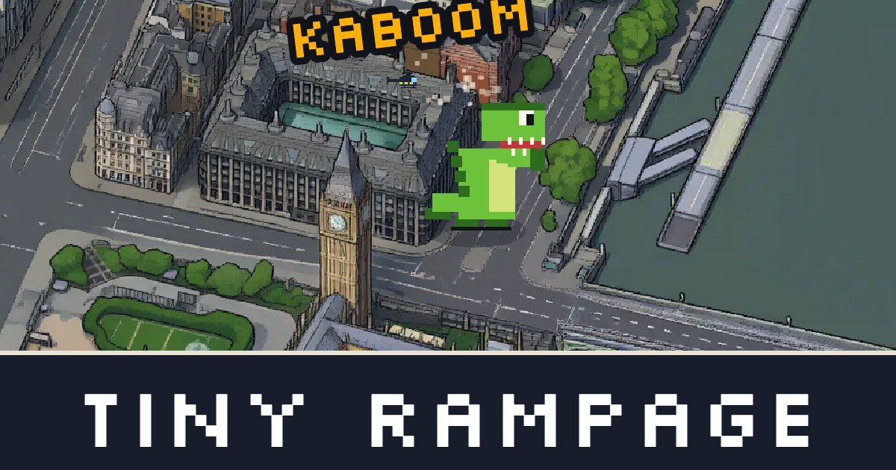

# Tiny Rampage

All of Zone 1 as a playable map you destroy. Built on [tiny.london](https://tiny.london/).

Play: https://tiny-rampage.pages.dev

## How it works

| Part | Source |
| --- | --- |
| Map art | [tiny.london](https://tiny.london/) tiles, loaded live. |
| Buildings | 45,000 OpenStreetMap outlines with heights. tiny.london publishes its camera projection in `map.json`. The same maths puts each outline on its building in the art. |
| Collapse | The game copies the building's pixels from the screen and slides them into the ground. |
| Police cars | They drive the OpenStreetMap road network. A shortest-path search from the monster runs every 0.4 seconds. |
| Zone 1 fence | The TfL Zone 1 boundary, from tiny.london. |
| Damage | Floor area at £4,000 a square metre. |

The game is one HTML file with a canvas and no libraries. It runs on Cloudflare Pages.

`prep_pbf.py` reads the Geofabrik Greater London extract and writes `game/buildings.json` and `game/roads.json`.

Built with Claude Code.

## Credits

Map art: tiny.london. Buildings and roads: © OpenStreetMap contributors, ODbL. Zone boundary: TfL Open Data.

## Licence

Code: MIT.
